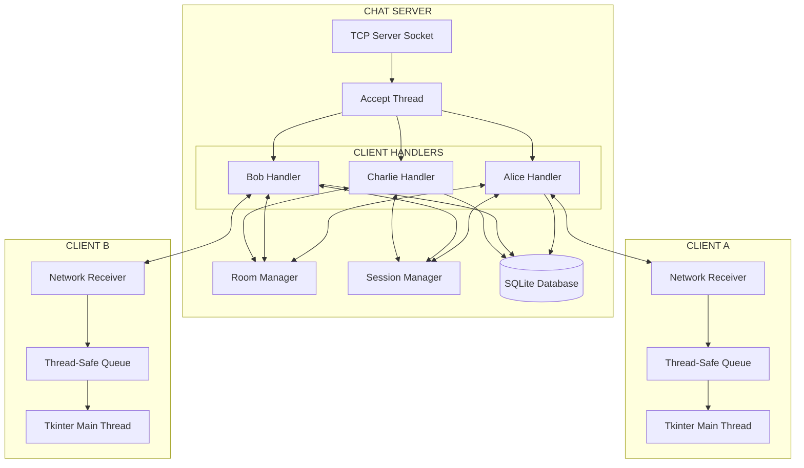
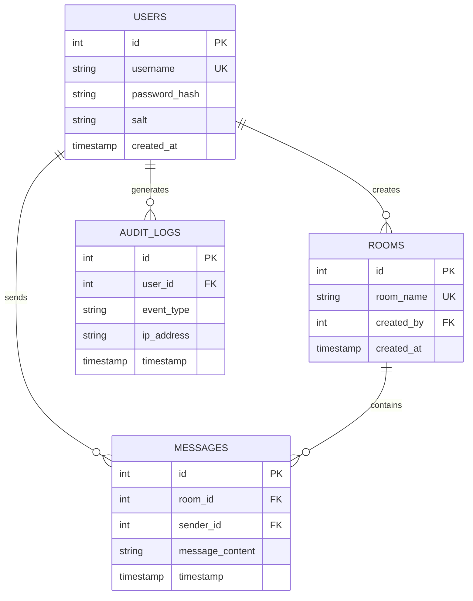

 <div align="center">

# ◈ CONNECT
### REAL-TIME CHAT APPLICATION

**Communicate. Collaborate. Connect.**

A Secure · Multi-Room · Real-Time Desktop Messaging Platform

<br/>


<br/>

[](https://www.python.org/)
[]()
[](https://www.sqlite.org/)
[]()
[](https://docs.pytest.org/)
[](LICENSE)

<br/>


</div>

---

<div align="center">

## ◈ PROJECT OVERVIEW

</div>

**Connect** (`ArnavSharma_Task5`) is a production-oriented, real-time desktop chat application developed using Python 3, low-level TCP sockets, multithreaded concurrency, SQLite, and Tkinter.

The application implements a custom newline-delimited JSON communication protocol, server-authoritative authentication, dynamically managed chat rooms, persistent message history, native emoji support, and a minimalist desktop interface.

Unlike conventional messaging demonstrations built using heavy web frameworks, Connect demonstrates how a complete client-server messaging system can be engineered using Python's standard networking and concurrency libraries.

### Core Philosophy

| Principle | Implementation |
|:---|:---|
| Real-Time Communication | TCP socket networking |
| Concurrency | Dedicated client handler threads |
| Security | PBKDF2-HMAC-SHA256 |
| Persistence | SQLite with WAL mode |
| Scalability Design | Independent client-server architecture |
| User Experience | Minimalist Tkinter / ttk interface |
| Reliability | Stream framing and packet validation |

---

## ◈ 01 — PROJECT INTRODUCTION

| Property | Details |
|:---|:---|
| Project Name | `ArnavSharma_Task5` |
| Application Name | Connect — Real-Time Chat Application |
| Repository | `ArnavSharma_Task5` |
| Programming Language | Python 3 |
| Architecture | Client-Server |
| Networking | TCP Sockets |
| Database | SQLite3 |
| GUI | Tkinter / ttk |
| Internship | Oasis Infobyte Python Programming |
| License | MIT |

Connect runs as two independent application components:

**1. Chat Server**

- Accepts incoming TCP connections.
- Authenticates users.
- Manages active sessions.
- Routes messages between subscribed room members.
- Persists messages and audit events.

**2. Desktop Client**

- Provides registration and login interfaces.
- Establishes a TCP connection to the server.
- Sends and receives JSON packets.
- Displays real-time messages.
- Manages room navigation and user preferences.

---

## ◈ 02 — KEY FEATURES

### Networking & Concurrency

- **Pure TCP Sockets:** Custom bidirectional socket communication.
- **JSON Stream Framing:** Newline-delimited JSON packets over UTF-8.
- **Multi-Client Concurrency:** Dedicated handler threads for connected clients.
- **Partial Packet Protection:** Buffers incomplete network fragments.
- **Packet Size Limit:** Rejects packets exceeding 64 KB.
- **Thread-Safe GUI:** Background receiver communicates through `queue.Queue`.
- **Non-Blocking Interface:** Tkinter processes events using `root.after()`.

### Security & Authentication

- **Server-Authoritative Authentication:** Credential checks and permissions are enforced by the server.
- **PBKDF2-HMAC-SHA256:** Password hashing with 100,000 iterations.
- **Unique Random Salts:** 16-byte cryptographically secure salts using `secrets`.
- **Constant-Time Verification:** Uses `hmac.compare_digest`.
- **Duplicate Session Rejection:** Prevents simultaneous active sessions for the same account.
- **Audit Logging:** Records connection and authentication events without recording passwords or private message content.

### Channels & Chat Rooms

- Dynamic room creation.
- Join and leave room functionality.
- Isolated room broadcasting.
- Default `#general` room.
- Real-time online member tracking.
- Join and leave notifications.
- Multiple concurrent conversations.

### Persistent Message History

- SQLite relational database.
- WAL (Write-Ahead Logging) mode.
- Parameterized SQL queries.
- Chronological message retrieval.
- Bounded message history.
- On-demand historical pagination.

### Desktop Interface & Emoji

- Minimalist open-canvas interface.
- Light and Dark themes.
- Persistent local preferences.
- Native operating-system emoji keyboard.
- Emoji shortcode conversion.
- Desktop sound notifications.
- Unread message counters in window titles.

---

## ◈ 03 — 3D-INSPIRED VISUAL IDENTITY

Connect uses a premium dark messaging aesthetic inspired by modern communication and developer collaboration platforms.

### Design Philosophy

- Floating chat composition.
- Layered sidebar and conversation regions.
- Minimalist message bubbles.
- Subtle violet highlights.
- Clean typography.
- Thin structural separators.
- Generous whitespace.
- Minimal decorative elements.

### DARK THEME — MIDNIGHT & SOFT VIOLET

| Element | Color |
|:---|:---|
| Background | `#111014` |
| Primary Surface | `#1B1820` |
| Secondary Surface | `#211D27` |
| Primary Accent | `#A987F5` |
| Secondary Accent | `#8B5CF6` |
| Primary Text | `#F2EFF7` |
| Secondary Text | `#A69BAF` |
| Borders | `#37303F` |

### LIGHT THEME — WARM PAPER & AMBER

| Element | Color |
|:---|:---|
| Background | `#F3EDE3` |
| Primary Surface | `#FAF7F1` |
| Secondary Surface | `#E9DFD0` |
| Primary Accent | `#C8793C` |
| Secondary Accent | `#B96C32` |
| Primary Text | `#29251F` |
| Secondary Text | `#81776A` |
| Borders | `#DED5C9` |

---

## ◈ 04 — SCREENSHOTS & VISUAL INTERFACE

<div align="center">

### APPLICATION THEMES

| Dark Theme | Light Theme |
|:---:|:---:|
|  |  |
| *Midnight theme with purple accents* | *Warm paper-inspired amber theme* |

### AUTHENTICATION & PREFERENCES

| Login & Registration | Preferences Modal |
|:---:|:---:|
|  |  |
| *Authentication and live validation* | *Themes and notification preferences* |

</div>

---

## ◈ 05 — TECHNOLOGY STACK

<div align="center">


</div>

| Component | Technology | Purpose |
|:---|:---|:---|
| Language | Python 3.10+ | Core application |
| GUI | Tkinter / ttk | Desktop interface |
| Networking | TCP Sockets | Client-server communication |
| Concurrency | threading | Multi-client handling |
| Synchronization | queue.Queue / threading.Lock | Thread safety |
| Database | SQLite3 | Persistent message storage |
| Cryptography | hashlib.pbkdf2_hmac | Password hashing |
| Randomness | secrets | Cryptographic salt generation |
| Protocol | Newline-Delimited JSON | Network communication |
| Testing | pytest | Automated testing |
| Packaging | PyInstaller | Executable compilation |

---

## ◈ 06 — SYSTEM ARCHITECTURE

<div align="center">

### MULTI-CLIENT CLIENT-SERVER ARCHITECTURE

</div>



### Thread Safety Model

**Server Side**

- Every incoming socket connection receives a dedicated `ClientHandler` thread.
- Database writes are protected using `threading.Lock`.
- SQLite WAL mode supports concurrent database access.
- Outgoing client socket broadcasts use individual `_send_lock` locks.

**Client Side**

- The network receiver operates independently in the background.
- Received packets are inserted into `queue.Queue`.
- Tkinter polls the queue every 50 milliseconds through `root.after()`.
- All graphical updates happen on the main UI thread.

**Important:** Socket operations and blocking network I/O are kept outside the Tkinter main thread.

---

## ◈ 07 — PROJECT DIRECTORY STRUCTURE

```text
ArnavSharma_Task5/
│
├── .gitignore
├── config.example.json
├── requirements.txt
├── README.md
│
├── server/
│   ├── __init__.py
│   ├── main.py
│   ├── server.py
│   ├── client_handler.py
│   ├── protocol.py
│   ├── room_manager.py
│   ├── auth.py
│   ├── database.py
│   └── config.py
│
├── client/
│   ├── __init__.py
│   ├── main.py
│   ├── network.py
│   ├── protocol.py
│   ├── message_handler.py
│   ├── notifications.py
│   └── config.py
│
├── gui/
│   ├── __init__.py
│   ├── theme.py
│   ├── login_window.py
│   ├── register_window.py
│   ├── chat_window.py
│   ├── room_sidebar.py
│   ├── message_view.py
│   ├── message_composer.py
│   └── settings.py
│
├── utils/
│   ├── __init__.py
│   ├── validators.py
│   ├── emoji.py
│   ├── timestamps.py
│   └── logger.py
│
├── data/
│   └── .gitkeep
│
└── tests/
    ├── __init__.py
    ├── conftest.py
    ├── test_validators.py
    ├── test_emoji.py
    ├── test_auth.py
    ├── test_database.py
    ├── test_room_manager.py
    ├── test_protocol.py
    └── test_integration.py
```

---

## ◈ 08 — INSTALLATION & SETUP

### Prerequisites

- Python 3.10 or higher.
- Tkinter support enabled.
- pip package manager.

For Linux:

```bash
sudo apt-get install python3-tk
```

### Step 1 — Clone Repository

```bash
git clone https://github.com/ArnavSharma/ArnavSharma_Task5.git

cd ArnavSharma_Task5
```

### Step 2 — Create Virtual Environment

```bash
python -m venv venv
```

### Step 3 — Activate Virtual Environment

**Windows**

```powershell
venv\Scripts\activate
```

**macOS / Linux**

```bash
source venv/bin/activate
```

### Step 4 — Install Dependencies

```bash
pip install -r requirements.txt
```

### Step 5 — Verify Installation

```bash
python -m pytest
```

---

## ◈ 09 — RUNNING THE APPLICATION

Connect requires the server and client to run independently.

### 1. Start the Chat Server

Open the first terminal:

```bash
python -m server.main
```

Default configuration:

```text
Host: 127.0.0.1
Port: 5000
Database: data/connect.db
```

Custom configuration:

```bash
python -m server.main --host 127.0.0.1 --port 5000 --db data/connect.db
```

### 2. Start the First Client

Open a second terminal:

```bash
python -m client.main
```

- Click Register.
- Create an account for Alice.
- Log in.
- Join the default `#general` room.

### 3. Start a Second Client

Open a third terminal:

```bash
python -m client.main
```

- Register a second account for Bob.
- Log in using Bob's credentials.
- Start exchanging messages with Alice.

### 4. Start Group Conversations

Create a room such as:

```text
#engineering
```

Invite additional connected users to join the same room and communicate in real time.

---

## ◈ 10 — USER GUIDE & FEATURES

### Account Registration

1. Click Register on the initial screen.
2. Enter a username between 3 and 20 characters.
3. Use alphanumeric characters, underscores or hyphens.
4. Create a password of at least 8 characters.
5. Include one uppercase letter, one lowercase letter and one digit.
6. Confirm your password.
7. Click Create Account.

### Login

1. Enter your registered username.
2. Enter your password.
3. Verify the server host and port.
4. Click Log In.
5. Duplicate active sessions are rejected automatically.

### Channels & Rooms

- Select a channel from the sidebar.
- Click `+ New` to create a room.
- Enter the room name.
- Press Enter.
- The server creates the room and joins you automatically.

Messages sent in one room are broadcast only to users subscribed to that room.

### Message Composer

| Action | Shortcut |
|:---|:---|
| Send Message | Enter |
| Insert New Line | Shift + Enter |
| Open Windows Emoji Picker | Win + . |
| Open Windows Emoji Picker | Win + ; |
| Open macOS Emoji Picker | Ctrl + Cmd + Space |

### Emoji Shortcodes

The application supports automatic shortcode conversion.

| Shortcode | Emoji |
|:---|:---:|
| `:smile:` | 😄 |
| `:rocket:` | 🚀 |
| `:fire:` | 🔥 |
| `:heart:` | ❤️ |
| `:check:` | ✔️ |
| `:tada:` | 🎉 |

Native Unicode emoji input is also supported.

### Themes & Preferences

1. Open Preferences in the sidebar.
2. Select Light or Dark mode.
3. Configure audio alerts.
4. Configure unread window-title notifications.
5. Click Save Preferences.

Preferences are stored in `client_config.json`.

---

## ◈ 11 — DATABASE ARCHITECTURE

Connect automatically creates an SQLite relational database:

```text
data/connect.db
```

Write-Ahead Logging is enabled for database concurrency.

### Entity Relationship Diagram



### Database Engineering

- SQLite WAL mode.
- Parameterized SQL queries.
- Foreign key constraints.
- Indexed historical retrieval.
- Message pagination.
- Transactional database operations.
- Persistent user and room information.

### Index Optimization

An index named `idx_messages_room_id_id` on `(room_id, id)` supports efficient room-specific message retrieval and pagination.

---

## ◈ 12 — WIRE PROTOCOL SPECIFICATION

Connect communicates over TCP using newline-delimited JSON packets.

Every packet is encoded as UTF-8 and terminated by a newline character.

### Client → Server Request

```json
{
  "action": "send_message",
  "request_id": "a1b2c3d4",
  "room_name": "general",
  "content": "Hello team! :rocket:"
}
```

### Server → Client Response

```json
{
  "type": "response",
  "action": "send_message",
  "status": "success",
  "request_id": "a1b2c3d4",
  "data": {
    "id": 42
  }
}
```

### Server → Clients Broadcast

```json
{
  "type": "broadcast",
  "event": "new_message",
  "data": {
    "id": 42,
    "room_name": "general",
    "sender": "Alice",
    "content": "Hello team! 🚀",
    "timestamp": "2026-11-18 14:35:00"
  }
}
```

### Stream Framing

TCP is a byte-stream protocol, meaning packet boundaries are not guaranteed.

Connect solves this through newline-delimited framing:

1. Receive arbitrary TCP fragments.
2. Append fragments to an internal buffer.
3. Extract complete newline-terminated packets.
4. Decode UTF-8.
5. Parse JSON.
6. Validate the packet.
7. Dispatch the requested action.

The protocol also enforces a 64 KB packet limit and handles malformed JSON without allowing arbitrary input to reach application handlers.

---

## ◈ 13 — SECURITY & PRIVACY TRANSPARENCY

### Cryptographic Guarantees

**Password Hashing**

Passwords are never stored in plaintext.

The application uses:

- PBKDF2-HMAC-SHA256.
- 100,000 iterations.
- 16-byte cryptographically random salt.
- Python `secrets` for salt generation.

Conceptually:

\[
H = PBKDF2\text{-}HMAC\text{-}SHA256(P,S,100000)
\]

Where:

- \(P\) = User password.
- \(S\) = Unique random salt.
- \(H\) = Derived password hash.

**Constant-Time Verification**

Credential verification uses:

```python
hmac.compare_digest()
```

This reduces timing differences during hash comparison.

**SQL Injection Protection**

All database queries use parameterized placeholders:

```python
cursor.execute(
    "SELECT * FROM users WHERE username = ?",
    (username,)
)
```

### Important Encryption Disclosure

> **Connect does not currently implement End-to-End Encryption (E2EE).**

- Messages are transmitted as plaintext JSON over standard TCP sockets.
- Messages are stored in readable text in the server's SQLite database.
- Administrators with access to the server machine may inspect stored messages.
- Network observers may inspect traffic on an unencrypted connection.
- The application is intended for local environments, development demonstrations and trusted intranets.
- The networking architecture is designed to support a future TLS wrapper through Python's `ssl` module.

---

## ◈ 14 — AUTOMATED TESTING

<div align="center">


### TESTING & QUALITY ASSURANCE

</div>

Connect includes 29 automated tests covering validation, authentication, database operations, protocol framing, room management and real TCP integration.

### Run All Tests

```bash
python -m pytest -v
```

### Test Coverage

| Test File | Testing Focus |
|:---|:---|
| `test_validators.py` | Username, password and input validation |
| `test_emoji.py` | Shortcode conversion and Unicode preservation |
| `test_auth.py` | PBKDF2 hashing and session deduplication |
| `test_database.py` | SQLite CRUD, pagination and audit logging |
| `test_protocol.py` | Packet framing and malformed JSON handling |
| `test_room_manager.py` | Room subscriptions and client cleanup |
| `test_integration.py` | Multi-client real TCP communication |

### Integration Testing Highlights

- Dynamic server port allocation.
- Multiple concurrent TCP clients.
- Real-time message exchange.
- Room isolation validation.
- Graceful client disconnections.
- Protocol framing verification.
- Authentication and session validation.

---

## ◈ 15 — TROUBLESHOOTING

| Issue | Cause | Solution |
|:---|:---|:---|
| Connection refused at `127.0.0.1:5000` | Server not running | Start `python -m server.main` |
| Port 5000 already in use | Port conflict | Use `--port 5050` |
| Username already exists | Existing account | Choose another username |
| Password validation failed | Complexity requirements unmet | Use uppercase, lowercase and a digit |
| Tkinter unavailable on Linux | Missing dependency | Install `python3-tk` |

### Custom Server Port

```bash
python -m server.main --port 5050
```

Ensure the client connects to the same host and port.

---

## ◈ 16 — STANDALONE EXECUTABLE PACKAGING

Connect supports packaging through PyInstaller.

### Install PyInstaller

```bash
pip install pyinstaller
```

### Build Desktop Client

```bash
pyinstaller --noconsole --name "Connect" --onefile client/main.py
```

The resulting executable is available inside:

```text
dist/
└── Connect.exe
```

The server remains a separate application component and must be started independently unless packaged separately.

---

## ◈ 17 — FUTURE ROADMAP

| Enhancement | Status |
|:---|:---:|
| Transport Layer Security (TLS) | Planned |
| Direct Messages | Planned |
| End-to-End Encryption | Planned |
| File & Image Transfers | Planned |
| Typing Indicators | Planned |
| Voice / Audio Channels | Planned |

### Future Technical Direction

**1. Transport Layer Security**

Wrap client-server socket communication with Python's `ssl` module and certificates.

**2. Direct Messages**

Introduce private one-to-one conversations.

**3. File & Image Transfers**

Implement chunked binary transfers and local caching.

**4. Typing Indicators**

Broadcast temporary typing events across subscribed rooms.

**5. Voice Channels**

Explore UDP-based peer-to-peer audio communication.

---

<div align="center">

## ◈ DEVELOPER

<h2>ARNAV SHARMA</h2>

**Computer Science & Artificial Intelligence**

<br/>

[](https://github.com/ArnavSharma-IND)

[](https://www.linkedin.com/in/arnav-sharma-dev/)

<br/>

**Project:** Connect — Real-Time Chat Application

**Repository:** `ArnavSharma_Task5`

**Internship:** Oasis Infobyte Python Programming

**Technology:** Python · TCP · SQLite · Tkinter

**License:** MIT

<br/>

*Engineered for communication. Designed for connection.*

<br/>


</div>